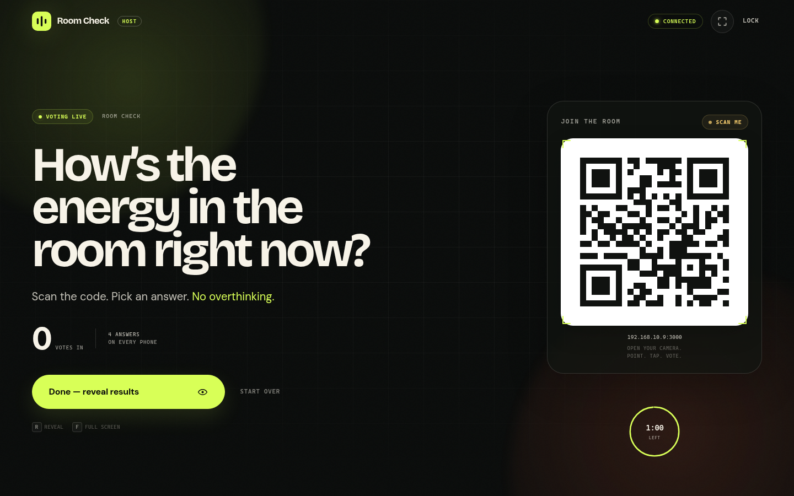
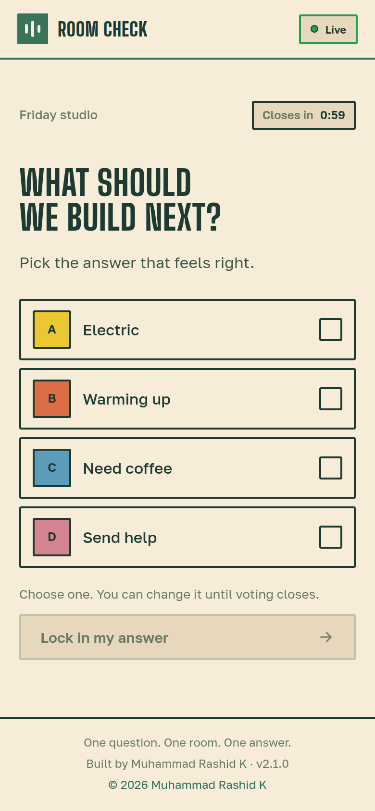
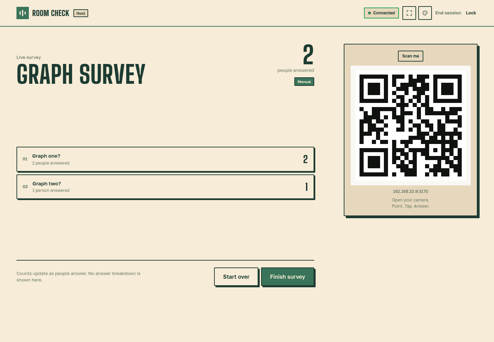
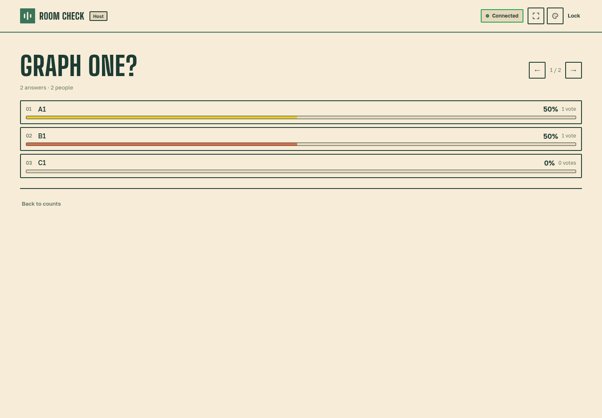
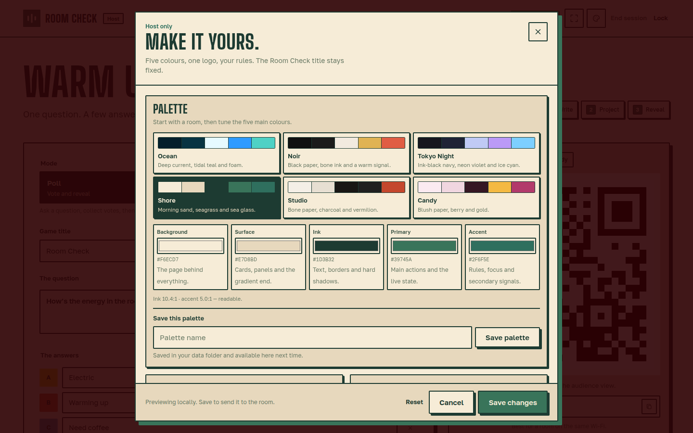
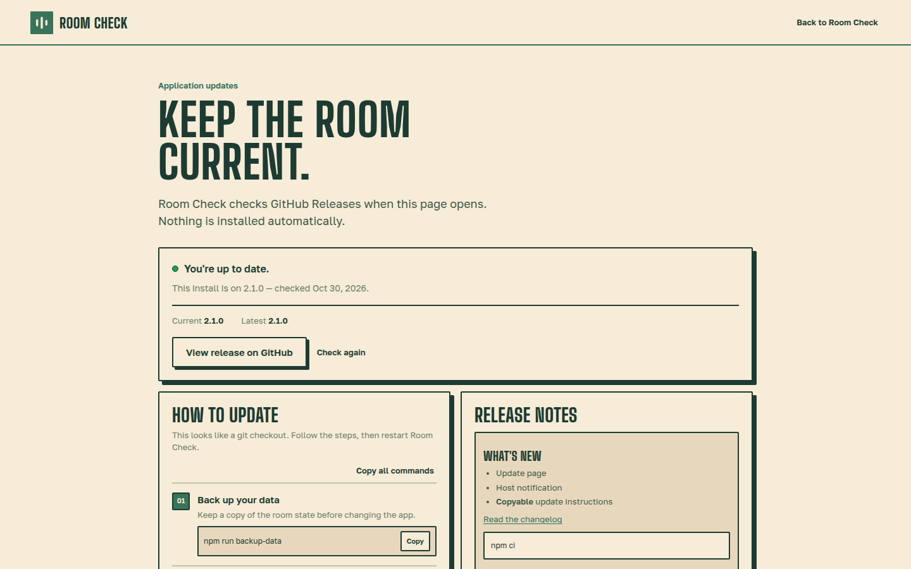

# Room Check

<p align="center">
  <strong>Created by <a href="https://github.com/mrashieee">Muhammad Rashid K</a></strong>
</p>

<p align="center">
  <a href="./LICENSE"></a>
  
  
  
  
</p>

A self-hosted, real-time audience poll for presentations. Run a vote with a big-screen reveal, or switch to **Live Hands** mode and watch the room raise and lower hands in real time. Show a QR code, let everyone participate from their phone, and control everything from your laptop.

<table align="center">
  <tr>
    <td width="73%" valign="middle">
      
    </td>
    <td width="27%" valign="middle">
      
    </td>
  </tr>
</table>

## Features

- Password-protected host console, configured on first launch
- Two modes: **Poll** and **Live Hands**
- Large QR code and live counts for the projector
- Mobile-first participation page
- Single-poll results hidden until the reveal
- Multi-question live surveys with audience-driven progression, QR joining, live response counts and post-survey graphs
- Import question sets from JSON files
- Change your answer until voting closes
- Looping waiting progress on audience screens
- Live raised-hand toggle with a presenter-side count
- End-of-session thank-you screen with a GitHub star link
- Automatic timer reveal or manual reveal
- Optional tie-breaker wheel when the top answers tie
- Animated, projector-friendly results
- Works on a local network or through a public HTTPS tunnel
- One Node.js process, no database and no build step
- All fonts and assets are served locally
- Optional systemd service for permanent self-hosting
- Six pre-packed palettes with Shore as the default
- Live theme customiser: colours, gradient, corners, buttons, answer palettes and logo
- Named custom palettes saved locally in `.data/palettes.json`
- Update page with release notes and copyable update instructions
- Host notification when a newer GitHub release is available

## What's new in 2.5.1

Version 2.5.1 is a bug-fix release for the live survey flow.

- Voters choose **Next question** instead of being advanced automatically
- After the survey closes, the audience sees the results instead of the thank-you screen
- Survey results are shown to the audience as question cards with answer bars

## What's new in 2.5

Version 2.5 adds the final survey presentation pieces.

- **QR on the live survey screen** — late joiners can scan while the survey is open
- **Post-survey graphs** — after **Finish survey**, the host can open results and move through one question graph at a time
- **Answer breakdowns only after closing** — live counts stay count-only during the survey
- **Previous and next controls** — navigate survey graphs without leaving the results view
- **Back to counts** — return to the live/final response dashboard

## What's new in 2.4

Version 2.4 turns a multi-question set into a live survey.

- **Audience-driven progression** — voters answer each question in order automatically; the host does not advance them
- **Back and review** — voters can go back or use the review screen to change any answer until the survey closes
- **Host live counts** — each question shows its name and how many people answered it
- **Counts only** — the host dashboard deliberately does not reveal answer breakdowns
- **Overall survey timer** — choose 1, 2, 5, 10, 15 or 30 minutes, or finish manually
- **Host finish** — close the survey and send the audience to the thank-you screen
- **Single poll and Live Hands stay separate** — their existing flows are unchanged

## What's new in 2.3

Version 2.3 makes question sets easier to prepare and import.

- **Multiple questions toggle** — turn the question set on only when you need it
- **JSON import** — load questions with `question` and `answers` attributes from a file
- **Example file** — start from `examples/questions.json`
- **Validation** — bad questions, answers, timers or duplicate answers are rejected with a clear message
- **Single-question default** — turn the toggle off for the original one-question flow

## What's new in 2.2

Version 2.2 introduced the first multi-question poll support and session persistence. Version 2.4 replaced the host-advanced progression with the audience-driven live survey flow.

## What's new in 2.1

Version 2.1 adds update awareness and a few audience-flow improvements.

- **Updates page** at `/updates`
- **Host notification** on the host setup screen when a newer release is available
- **GitHub Releases check** with a six-hour cache
- **Current and latest version** shown clearly
- **Release notes** from the published GitHub Release
- **Step-by-step install-specific instructions** for git checkouts and archive installs
- **Copy buttons** for every command and a “Copy all commands” action
- **Release notes rendered as Markdown**
- **Cross-platform backup** with `npm run backup-data`; no `tar` requirement
- **No automatic updates** — Room Check never executes an update on its own
- **Config controls** for `UPDATE_CHECK`, `UPDATE_REPO` and `UPDATE_API_URL`
- **Change your answer** until voting closes; a rejected late change keeps the previous vote
- **Looping waiting progress** on the audience waiting and voted screens
- **Timestamped `npm run share` progress** with elapsed time and health-check updates

The host notice links to the update page. The page works without host login, so anyone running Room Check can check for a release.

## What's new in 2.0

Version 2.0 is the customisation release.

- **Theme customiser** — palette icon in the host header
- **Six palettes, three dark and three light** — Ocean, Noir, Tokyo Night, Shore, Studio, Candy
- **Shore default** — morning sand, seagrass and sea glass
- **Five main colours** — Background, Surface, Ink, Primary and Accent
- **Flat or gradient background** — dedicated Start and End colours plus angle
- **Sharp, soft or round corners**
- **Solid, outline or minimal buttons**
- **Six answer-colour palettes** — Print, Bright, Cool, Warm, Mono, Garden
- **Custom logo** — PNG, JPG, WebP or SVG up to 256 KB
- **Named custom palettes** saved in `.data/palettes.json`
- **Live audience theming** — save once and every phone updates
- **Design refresh** — paper/ink surfaces, hard edges, a new waiting screen, centred QR, universal connection colours and a black-and-white GitHub mark

Existing `carnival` state migrates to Shore; `orchard` state migrates to Candy. Your data is preserved.

## Contents

- [What's new in 2.5.1](#whats-new-in-251)
- [What's new in 2.5](#whats-new-in-25)
- [What's new in 2.4](#whats-new-in-24)
- [What's new in 2.3](#whats-new-in-23)
- [What's new in 2.2](#whats-new-in-22)
- [What's new in 2.1](#whats-new-in-21)
- [What's new in 2.0](#whats-new-in-20)
- [Quick start](#quick-start)
- [Which setup should I use?](#which-setup-should-i-use)
- [Requirements](#requirements)
- [1. Download the project](#1-download-the-project)
- [2. Install](#2-install)
- [3. Start and secure the host console](#3-start-and-secure-the-host-console)
- [4. Connect the audience](#4-connect-the-audience)
- [5. Run a poll or survey](#5-run-a-poll-or-survey)
- [Customise the room](#customise-the-room)
- [Configuration](#configuration)
- [Data, backups, and password resets](#data-backups-and-password-resets)
- [Permanent hosting and HTTPS](#permanent-hosting-and-https)
- [Troubleshooting](#troubleshooting)
- [Updating](#updating)
- [Presentation-day checklist](#presentation-day-checklist)
- [Security](#security)
- [Development](#development)
- [Project layout](#project-layout)
- [Changelog](./CHANGELOG.md)
- [License](#license)

## Quick start

Requirements: **Node.js 22.9 or newer** and npm.

```bash
npm install
npm start
```

Open the host console at [http://localhost:3000/host](http://localhost:3000/host). The terminal prints a one-time setup code. Enter it, create a password, and the host console unlocks.

The audience link is printed in the terminal. If the audience is not on the same Wi-Fi, stop the server and use:

```bash
npm run share
```

Wait for **Public link verified and ready**, then use the printed HTTPS link. The QR code automatically uses it.

## Which setup should I use?

| Goal | Recommended setup |
| --- | --- |
| Try it on one computer | `npm start`, open the host console |
| Audience on the same Wi-Fi | `npm start`, use the LAN audience link |
| Audience on cellular or another network | `npm run share` |
| Live audience pulse / raised hands | Choose **Live Hands** in host setup |
| Permanent domain and HTTPS | Node.js behind a reverse proxy, with `PUBLIC_URL` set |

`npm start` and `npm run share` both serve the app on port 3000. Run only one of them at a time.

## Requirements

- **Node.js 22.9+** — check with `node --version`
- **npm** — included with Node.js
- Bash, PowerShell, or another terminal
- Internet access for the initial install and for public tunnels

If Node.js is not installed, download the current LTS release from [nodejs.org](https://nodejs.org/). On Linux or macOS, a version manager such as `nvm` also works.

## 1. Download the project

Clone this repository:

```bash
git clone https://github.com/mrashieee/room-check.git
cd room-check
```

If you do not use Git, open the repository on GitHub, choose **Code → Download ZIP**, extract it, and open a terminal in the extracted folder.

On Windows, use PowerShell. Most commands are identical; replace Unix-only commands such as `cp` with their PowerShell equivalent.

## 2. Install

```bash
npm install
```

No build step is needed.

Optional configuration:

```bash
cp .env.example .env
```

On Windows PowerShell:

```powershell
Copy-Item .env.example .env
```

The defaults work for a local trial. See [Configuration](#configuration) before exposing the app publicly.

> `npm install` may warn that the optional Cloudflare tunnel helper skipped an install script. This is harmless. The helper is downloaded automatically the first time you run `npm run share`.

## 3. Start and secure the host console

Start Room Check:

```bash
npm start
```

The terminal prints something like:

```text
ROOM CHECK
──────────────────────────────────────────────────────────
Audience     http://192.168.1.42:3000
Host console http://localhost:3000/host
Host auth    First-run setup needed
──────────────────────────────────────────────────────────
FIRST-RUN SETUP CODE: ABCD-EFGH
Open the host console and create your password.
```

Open the host console:

```text
http://localhost:3000/host
```

On the first launch:

1. Enter the one-time setup code from the terminal.
2. Create a host password. It must be at least 8 characters.
3. Confirm the password.

The password is stored as an `scrypt` hash in `.data/auth.json`. The setup code is only required once. After that, the same password is used to unlock the host console.

Important:

- **Keep the terminal open.** It is the app log and can show errors or the setup code.
- The setup code is only printed while no password has been configured. If you miss it, restart the process to generate a new one.
- Host sessions last 12 hours.
- If Room Check is running on a remote server with no browser, open `https://your-domain/host` or use an SSH tunnel:

```bash
ssh -L 3000:localhost:3000 user@your-server
```

Then open `http://localhost:3000/host` locally.

### Stop and restart

Press `Ctrl+C` in the terminal to stop the server.

To start it again later:

```bash
npm start
```

The host password and the current poll are kept in `.data/`. The setup code will not be shown again.

## 4. Connect the audience

### Same Wi-Fi

With `npm start` running, use the **Audience** URL printed in the terminal, for example `http://192.168.1.42:3000`. Phones must be on the same Wi-Fi network.

If phones cannot connect:

- Make sure the phone is not on a guest or isolated network.
- Allow inbound TCP port 3000 through the host firewall.
- Use `npm run share` if the venue isolates devices from each other.

### Public link

For phones on cellular or another network, stop `npm start` and run:

```bash
npm run share
```

This creates a temporary Cloudflare quick tunnel and prints an HTTPS address. The QR code and the **Audience** URL use that address automatically.

The first run downloads a small tunnel helper. Cloudflare can take a minute or two to propagate a new hostname; wait for **Public link verified and ready** in the terminal before sharing the QR. Each startup step is timestamped with elapsed time, including the public-link health checks.

Keep the process running for the whole event. The public URL is temporary and generally changes every time you restart `npm run share`.

Do not run `npm start` and `npm run share` at the same time — both use port 3000.

### Custom domain or permanent URL

For a stable URL, run Room Check behind a reverse proxy with HTTPS and set `PUBLIC_URL`. See [Permanent hosting and HTTPS](#permanent-hosting-and-https).

## 5. Run a poll or survey

### Single-question poll

1. Leave **Multiple questions** off.
2. Enter a game title, a question and 2–10 answers.
3. Choose a voting window: 30, 60, 90 or 120 seconds, or **Manual**.
4. Leave **If tied, spin the wheel** enabled if you want a tie settled by the live wheel.
5. Check the audience link under the QR preview.
6. Press **Open the room**.
7. Press **Done — reveal results** or let the timer reveal automatically.
8. Choose **Play it again** or **New question**.

Single-poll results stay hidden from the audience until the reveal.

### Multi-question live survey

1. Turn on **Multiple questions**.
2. Add up to 20 questions, or use **Import JSON**.
3. Give each question 2–10 answers. Each question has its own answers; the survey has one overall timer.
4. Choose a **Survey window**: Manual, 1, 2, 5, 10, 15 or 30 minutes.
5. Check the audience link, then press **Start N-question survey**.
6. The survey screen shows the QR code so late joiners can scan while it is open.
7. The audience chooses an answer, then presses **Next question** to continue. They can go **Back** or use the review screen to change answers until the survey closes.
8. The host dashboard shows each question name and how many people answered it, updating live.
9. Press **Finish survey** when the room is done, or let the overall timer close it.
10. The audience sees the survey results themselves. The host keeps the final response counts.
11. Press **View results** on the host dashboard to open the answer graphs one question at a time. Use the arrows to move between questions, or **Back to counts** to return.

The host does not advance questions and does not see answer breakdowns in survey mode.

<p align="center">
  
</p>

After **Finish survey**, choose **View results** to see the answer graph for each question one at a time.

<p align="center">
  
</p>

If a single poll is tied and the wheel is enabled, the host screen shows a spinning wheel with all tied answers. The server picks the winner at random, the wheel lands on it, and the final results then show the wheel pick. Phones show a “watch the big screen” message while the wheel is spinning.

### Import questions from JSON

Turn on **Multiple questions**, choose **Import JSON** in the question set panel, and select a `.json` file. The survey uses one overall **Survey window**; per-question timers are not part of the file.

#### Recommended format

```json
{
  "questions": [
    {
      "question": "What should we build next?",
      "answers": ["Electric", "Warming up", "Need coffee", "Send help"]
    },
    {
      "question": "What should we ship first?",
      "answers": ["The map", "The radio", "The lights"]
    },
    {
      "question": "Who should lead it?",
      "answers": ["Design", "Engineering", "Everyone"]
    }
  ]
}
```

Each question object has two required fields:

| Field | Required | Rules |
| --- | --- | --- |
| `question` | Yes | Text, up to 160 characters |
| `answers` | Yes | Array of 2–10 different answers, each up to 52 characters |

The top-level file can also be:

- A plain array of question objects:

```json
[
  {
    "question": "What should we build next?",
    "answers": ["Electric", "Warming up", "Need coffee"]
  }
]
```

- A single question object, if you only have one question:

```json
{
  "question": "What should we build next?",
  "answers": ["Electric", "Warming up", "Need coffee"]
}
```

#### Import rules

- Maximum 20 questions.
- Each question needs at least 2 answers and no more than 10.
- Answers must be different within the same question.
- The file must be valid JSON and no larger than 256 KB.
- Importing replaces the current question set. If the current set has more than one question, Room Check asks for confirmation first.
- The **Survey window** controls the whole survey; it is not read from the JSON file.
- Choose the survey time in the host UI: **Manual**, **1**, **2**, **5**, **10**, **15** or **30 minutes**.

A ready-to-import example is available at [`examples/questions.json`](./examples/questions.json).

### Live Hands mode

Choose **Live Hands** in the host setup to run a quick room pulse instead of a poll.

1. Enter the question, for example “Who has used an AI assistant today?”
2. Press **Open live hands**.
3. The audience gets one large **Raise hand** button. They can tap **Put hand down** at any time.
4. The host screen shows the live count of raised hands.
5. Press **Done — hands down** to close the room and keep the final count.
6. Use **New question** to return to setup.

Live Hands has no answer choices, timer, results reveal, or tie-breaker. It is intentionally a fast, live count for the presenter.

### End the session

Use **End session** in the host header to close the event.

- For single polls and Live Hands, the audience sees a **Thanks for joining** screen with a button to star Room Check on GitHub.
- For surveys, the audience sees the survey results. The host keeps the response counts and graph view.
- **Back to setup** clears the closed session and returns to the host setup.

The session ends even if the browser host page stays open. The closed state is stored on the server, so reloading either side keeps showing the result until the host returns to setup or starts a new round.

Host shortcuts:

| Key | Action |
| --- | --- |
| `R` | Reveal results |
| `F` | Toggle full screen |

Each browser can answer each question once. Voters can change answers until the survey closes. Single-poll results are withheld from the audience until the reveal; survey hosts see response counts only, not answer breakdowns.

The audience sees a waiting screen before a round starts and automatically switches to the voting screen when the host opens the room.

## Customise the room

Click the palette icon in the host header to open the theme customiser. Changes preview live on the host screen; nothing is sent to the audience until you press **Save changes**.

<p align="center">
  
</p>

### Palette

Choose one of six pre-packed palettes:

| Palette | Mood |
| --- | --- |
| Ocean | Deep current, tidal teal, foam |
| Noir | Black paper, bone ink, amber and vermilion |
| Tokyo Night | Ink-black navy, neon violet and ice cyan |
| Shore | Morning sand, seagrass and sea glass — default |
| Studio | Bone paper, charcoal and vermilion |
| Candy | Blush paper, berry and gold |

Then tune the five main colours:

- **Background** — page base
- **Surface** — panels and cards
- **Ink** — text, borders and shadows
- **Primary** — main actions and live state
- **Accent** — rules, focus and secondary signals

### Background

Choose **Flat** or **Gradient**. For a gradient, choose a **Start colour**, **End colour** and angle. Panels keep the Background and Surface colours, so the page wash stays behind the content.

### Shape and controls

- **Corners** — Sharp, Soft or Round
- **Buttons** — Solid, Outline or Minimal
- **Answer colours** — Print, Bright, Cool, Warm, Mono or Garden

### Logo

Upload a PNG, JPG, WebP or SVG up to 256 KB. The Room Check title stays fixed. The preview is 112px on desktop and 88px on mobile. Use **Remove logo** to return to the default theme-coloured mark.

### Save a custom palette

Name the current five colours and press **Save palette**. It is stored in `.data/palettes.json` and appears in the Palette list next time. The live theme is still saved separately with **Save changes**.

### Save, cancel and reset

- **Save changes** sends the theme to every audience screen
- **Cancel** restores the last saved theme
- **Reset** loads the default Shore theme into the draft

The customiser is host-only. The audience receives the saved theme over the live WebSocket state.

## Configuration

Configuration is optional and read from `.env` when using `npm start` or `npm run share`.

| Variable | Default | Description |
| --- | --- | --- |
| `PORT` | `3000` | HTTP port |
| `BIND_ADDRESS` | `0.0.0.0` | Network address the server binds to |
| `PUBLIC_URL` | automatic | Public base URL used by the audience QR code |
| `DATA_DIR` | `./.data` | Directory for the password, session secret, and poll state |
| `SESSION_SECRET` | generated | Optional signing secret for host sessions |
| `UPDATE_CHECK` | `on` | Set to `off` to disable GitHub release checks |
| `UPDATE_REPO` | `mrashieee/room-check` | GitHub repository used by the update checker |
| `UPDATE_API_URL` | GitHub latest-release API | Optional override for a mirror or local test |

Example `.env`:

```dotenv
PORT=3000
PUBLIC_URL=https://poll.example.com
# BIND_ADDRESS=0.0.0.0
# SESSION_SECRET=replace-with-a-long-random-string
```

### `PUBLIC_URL`

This is the address that phones will use. It affects the QR code and the audience link shown in the host console, not the port the server listens on.

- Same Wi-Fi: usually left unset; it falls back to the machine's LAN address.
- Reverse proxy or custom domain: set it to the full HTTPS origin, such as `https://poll.example.com`.

Do not include a path after the origin.

### Data directory

The default data directory is:

```text
.data/
├── auth.json          # password hash and session identifier
├── session-secret     # generated session signing secret
├── state.json         # current round, votes, results and active theme
├── palettes.json      # named custom palettes, when saved
└── theme-logo.<ext>   # uploaded logo, when set
```

The server restricts these files to the owner where the filesystem supports permissions. Do not serve `.data/` from a web server.

## Data, backups, and password resets

### Back up

Stop the app first for a consistent snapshot, then copy the whole `.data` directory:

```bash
npm run backup-data
```

### Restore

Stop the app, replace `.data` with the backup contents, and restart.

### Reset the host password

Stop the server and run:

```bash
npm run reset-password
npm start
```

Restarting prints a new first-run setup code. The poll data is preserved. Old host sessions are invalidated once the new password is set.

### Delete all data

```bash
rm -rf .data
```

This removes the password, session secret, and current poll. It cannot be undone.

## Permanent hosting and HTTPS

For a permanent public deployment, use HTTPS. The host password is sent to the server during login and must not travel over plain HTTP.

### Run with systemd

Create a service user and install the app in `/opt/room-check`:

```bash
sudo useradd --system --create-home --shell /usr/sbin/nologin roomcheck
sudo mkdir -p /opt/room-check
sudo chown roomcheck:roomcheck /opt/room-check

sudo -u roomcheck git clone https://github.com/mrashieee/room-check.git /opt/room-check
cd /opt/room-check
sudo -u roomcheck npm install
sudo -u roomcheck cp .env.example .env
```

Edit `/opt/room-check/.env`:

```dotenv
PORT=3000
PUBLIC_URL=https://poll.example.com
```

Create `/etc/systemd/system/room-check.service`:

```ini
[Unit]
Description=Room Check
After=network-online.target
Wants=network-online.target

[Service]
Type=simple
User=roomcheck
Group=roomcheck
WorkingDirectory=/opt/room-check
Environment=NODE_ENV=production
ExecStart=/usr/bin/env npm start
Restart=always
RestartSec=3

[Install]
WantedBy=multi-user.target
```

Enable it:

```bash
sudo systemctl daemon-reload
sudo systemctl enable --now room-check
sudo journalctl -u room-check -f
```

The setup code appears in the journal. If `node` or `npm` is installed outside systemd’s default PATH, use the absolute path in `ExecStart`.

### Caddy + HTTPS

Install Caddy and use `/etc/caddy/Caddyfile`:

```caddyfile
poll.example.com {
    reverse_proxy 127.0.0.1:3000
}
```

Reload Caddy:

```bash
sudo systemctl reload caddy
```

Caddy handles HTTPS and WebSockets automatically.

### Nginx

If you use Nginx, enable WebSocket upgrades and forwarded headers:

```nginx
location / {
    proxy_pass http://127.0.0.1:3000;
    proxy_http_version 1.1;
    proxy_set_header Upgrade $http_upgrade;
    proxy_set_header Connection "upgrade";
    proxy_set_header Host $host;
    proxy_set_header X-Forwarded-Proto $scheme;
}
```

### Deployment requirements

- Node.js 22.9+
- A persistent disk or volume for `.data`
- WebSocket support
- HTTPS in front of the app
- **One instance only** — the live poll is stored in memory and mirrored to disk, so do not scale to multiple replicas
- `PUBLIC_URL` set if the public URL differs from the address used to open the host console

Render, Railway, Fly.io, and VPS providers can all run the app. On free tiers, check whether the service sleeps or uses an ephemeral filesystem; either can interrupt a live poll or lose the host password.

## Troubleshooting

| Problem | Fix |
| --- | --- |
| `EADDRINUSE` or “port already in use” | Another server is using port 3000. Stop it or set a different `PORT`. |
| Setup code is missing | Restart the app. If no password has been set, a new code appears in the terminal. |
| Forgot the host password | Stop the app, run `npm run reset-password`, start it again, and use the new setup code. |
| “That setup code is not right” | Copy the current code exactly. If the server restarted, the code changed. Use the one from the latest startup. |
| Host page does not load | Make sure the terminal process is still running. Check `http://localhost:3000/healthz`. |
| Phones on the same Wi-Fi cannot connect | Confirm both devices are on the same non-guest network, allow port 3000 through the firewall, or use `npm run share`. |
| QR code points to `localhost` or the wrong address | Set `PUBLIC_URL`, or paste the correct address into the **Audience link** field before opening a round. |
| Public link shows a Cloudflare 530 error right after startup | Wait for **Public link verified and ready**. If it persists, restart `npm run share`. |
| Public link stopped working | The `npm run share` process was stopped or lost connectivity. Run it again; the URL will change. |
| Votes or results do not update | A proxy may be blocking WebSockets. The app falls back to polling every 3 seconds; check the reverse proxy’s WebSocket support. |
| Host login expired | Host sessions last 12 hours. Log in again. |
| `npm run share` cannot download the tunnel helper | The network blocks GitHub or Cloudflare. Use the LAN mode or deploy behind a domain. |
| The tunnel helper install warning appears during `npm install` | It is safe to ignore; the helper downloads automatically when needed. |

## Updating

Open `/updates` on your Room Check server, or click the update notice on the host setup screen. The page shows the current version, the latest GitHub Release, release notes and the correct update commands for the detected install method.

<p align="center">
  
</p>

The check uses GitHub Releases and is cached for six hours. It does not install anything automatically. The update is always a host action.

Before updating:

1. Back up `.data`.
2. Do not update during a live poll or Live Hands round.
3. Keep one Room Check instance running.

For a git checkout, the page shows:

```bash
npm run backup-data
git fetch --tags
git checkout <latest-release-tag>
npm ci
# restart Room Check
```

`npm run backup-data` copies `.data` to a timestamped backup and works on Windows, macOS and Linux. No `tar` command is required.

For an archive install, download the release ZIP, replace the app files, keep `.data/` and `.env`, run `npm ci`, then restart.

Check the [CHANGELOG](./CHANGELOG.md) for release notes.

## Presentation-day checklist

1. Start Room Check before the audience arrives.
2. If using `npm run share`, wait for the verified public link and test it on a phone using cellular data.
3. Log in to the host console and create the poll.
4. Keep the laptop awake, connected, and plugged in.
5. Increase screen brightness so the QR code scans easily.
6. Keep the terminal window open.
7. Open the room only when the QR is on screen.
8. Press **Done** or let the timer reveal the results.

## Security

- The host password is hashed with `scrypt`; plaintext passwords are never stored.
- The first-run setup code prevents someone from claiming a freshly exposed instance.
- Login and setup attempts are rate-limited.
- Host sessions are signed HttpOnly, SameSite cookies and expire after 12 hours.
- Results are not included in the audience state until the host or timer reveals them.
- Use HTTPS for any deployment reachable over the internet.
- Keep `.env`, `.data/`, and backups private. They contain the host auth material and poll data.
- Run a single app instance. Do not put the local data directory on a shared network filesystem.

## Development

```bash
npm run dev
npm run check
```

`npm run dev` restarts the server when server-side files change. Browser assets are served directly, so no build step is required.

Useful commands:

```bash
npm start             # run the server with .env
npm run share         # run with a temporary public Cloudflare tunnel
npm run reset-password
npm run backup-data   # copy .data to a timestamped backup
npm run check         # syntax checks
```

## Project layout

```text
server.mjs                 HTTP server, polling state, auth, WebSockets, theme API
public/
├── player.html             audience page
├── host.html               host console
├── player.js               audience behavior
├── host.js                 host behavior
├── common.js               shared client helpers
├── theme-config.js         palettes, validation, theme variables
├── theme.js                applies theme, logo and favicon
├── customizer.js           host-only theme customiser
├── updates.html            update page
├── updates.js              update page behavior
├── styles.css              original base layer
├── carnival.css            active design and customiser styles
└── fonts/                  local fonts
scripts/
├── share.mjs               temporary Cloudflare tunnel
├── reset-password.mjs      password reset helper
└── backup-data.mjs         cross-platform .data backup
docs/                       README screenshots
CHANGELOG.md                release history
.env.example
LICENSE
```

Stack: Node.js, Express, `ws`, `qrcode`, and vanilla browser JavaScript.

## License

<p align="center">
  <a href="./LICENSE"></a>
</p>

<p align="center">
  <strong>MIT License</strong><br />
  Copyright © 2026 Muhammad Rashid K
</p>

Room Check is free to use, modify, distribute, and self-host. The full license text is in [LICENSE](./LICENSE).

---

<p align="center">
  <strong>Room Check</strong><br />
  Built by <a href="https://github.com/mrashieee">Muhammad Rashid K</a><br />
  <sub>MIT licensed · © 2026</sub>
</p>
