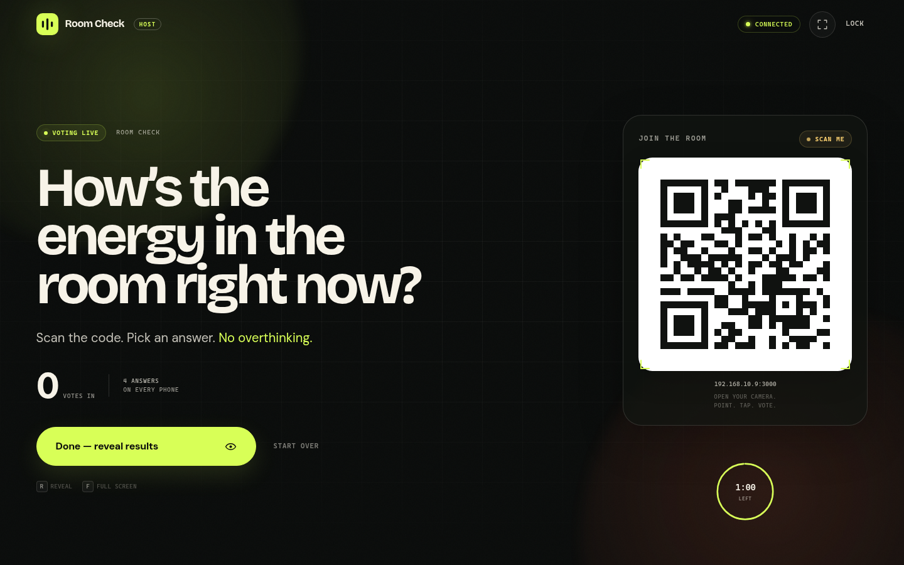
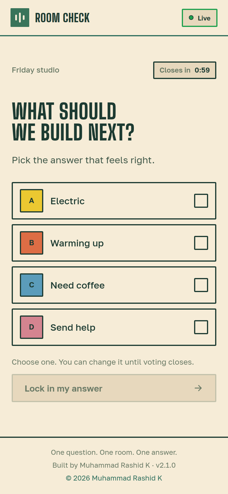
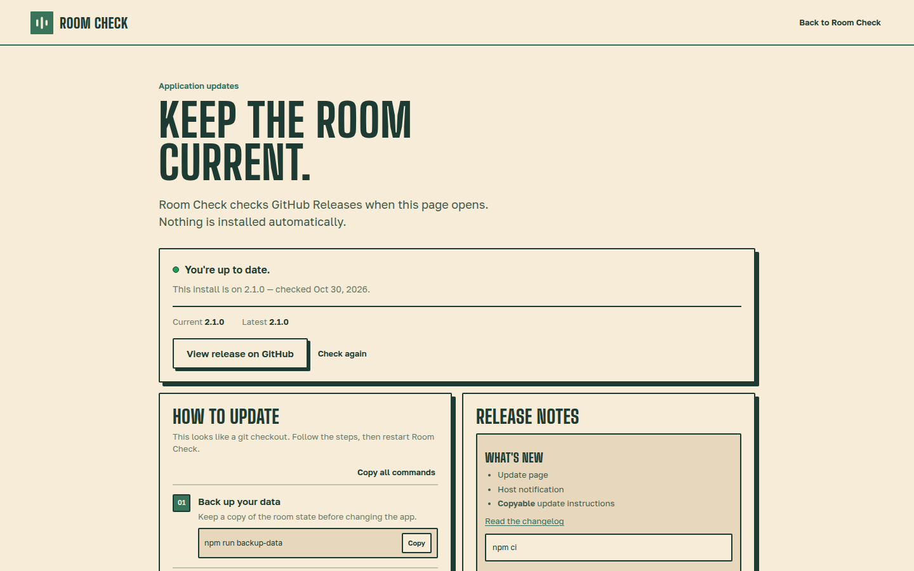

# Room Check

<p align="center">
  <strong>Created by <a href="https://github.com/mrashieee">Muhammad Rashid K</a></strong>
</p>

<p align="center">
  <a href="./LICENSE"></a>
  
  
  
  
</p>

Room Check is a self-hosted presenter assistant for the room in front of you and the audience joining from somewhere else. Build a slide deck, show it on the projector, control it from your phone, and let the audience join by QR for silent prompts, polls, hands and surveys.

It is **offline-first**: the presenter laptop owns the slides and the presentation state. Audience screens do not display the deck or a live video stream. When people are not on the same network, the app uses a temporary Cloudflare tunnel for the web page, API and WebSocket updates — not for video.

<table align="center">
  <tr>
    <td width="73%" valign="middle">
      
    </td>
    <td width="27%" valign="middle">
      
    </td>
  </tr>
</table>

## What it does

- **Projector slides:** upload images or a PDF, show the deck full-screen at `/present`.
- **Phone controller:** pair a phone by QR or host password, then change slides, fit the projector, scroll tall slides, run quick polls and raise Live Hands.
- **Silent audience screen:** `/join` shows a calm attention screen, then switches to voting, hand raising or survey questions when the host starts them.
- **Host console:** create polls and multi-question surveys, reveal results, run the wheel, customise the theme and manage backups.
- **Tunnel-ready audience link:** run `npm run share` and the QR/link automatically use a temporary public HTTPS address.
- **Share card:** `/share` shows the audience QR and link, with a downloadable 1920×1080 PNG for a slide.
- **Desktop shell:** on desktop, the header and footer stay visible while only the middle content scrolls. Phones keep normal page scrolling.
- **No media server:** no WebRTC, TURN, SFU, camera or screen sharing to audience phones. That is deliberate.

## What it does not do

- It does not stream your screen or camera to audience phones.
- It does not create permanent meeting rooms or video calls.
- It does not carry video through the tunnel.
- It does not need TURN, an SFU, or a paid media service.

For a remote event, present on your laptop/projector and let the audience watch through your normal meeting tool if they need live video. Use Room Check for the interactive layer: polls, hands, surveys and prompts.

## Contents

- [Quick start](#quick-start)
- [Which setup should I use?](#which-setup-should-i-use)
- [Requirements](#requirements)
- [1. Install](#1-install)
- [2. Start and secure the host console](#2-start-and-secure-the-host-console)
- [3. Connect the audience](#3-connect-the-audience)
- [4. Build and run a presentation](#4-build-and-run-a-presentation)
- [5. Run a poll, survey or Live Hands](#5-run-a-poll-survey-or-live-hands)
- [6. Share the audience link](#6-share-the-audience-link)
- [Customise the room](#customise-the-room)
- [Configuration](#configuration)
- [Data, backups and password resets](#data-backups-and-password-resets)
- [Permanent hosting and HTTPS](#permanent-hosting-and-https)
- [Troubleshooting](#troubleshooting)
- [Updating](#updating)
- [Presentation-day checklist](#presentation-day-checklist)
- [Security and privacy](#security-and-privacy)
- [Development](#development)
- [Project layout](#project-layout)
- [Roadmap](#roadmap)
- [License](#license)

## Quick start

Requirements: **Node.js 22.9 or newer** and npm.

```bash
npm install
npm start
```

Open the host console at [http://localhost:3000/host](http://localhost:3000/host). The terminal prints a one-time setup code. Enter it, create a password, and the host console unlocks.

Then open [http://localhost:3000/present](http://localhost:3000/present) to build a deck, or [http://localhost:3000/host](http://localhost:3000/host) for a quick poll or survey.

For an audience outside your Wi-Fi, stop `npm start` and run:

```bash
npm run share
```

Wait for **Public link verified and ready**, then share the printed HTTPS link or the QR from `/share`.

## Which setup should I use?

| Goal | Recommended setup |
| --- | --- |
| Try it on one computer | `npm start` |
| Audience on the same Wi-Fi | `npm start`, use the LAN audience link |
| Audience on cellular or another network | `npm run share` |
| Projector slides + phone controller | Open `/present`, then scan the controller QR |
| Quick poll, survey or wheel | Open `/host` |
| Permanent domain and HTTPS | Run behind a reverse proxy with `PUBLIC_URL` set |

`npm start` and `npm run share` both serve the app on port 3000. Run only one of them at a time.

## Requirements

- **Node.js 22.9+** — check with `node --version`
- **npm** — included with Node.js
- A modern browser for the host and projector
- Internet access for the initial install and for public tunnels
- A laptop that can stay awake and connected for the whole event

If Node.js is not installed, download the current LTS release from [nodejs.org](https://nodejs.org/). On Linux or macOS, a version manager such as `nvm` also works.

## 1. Install

```bash
git clone https://github.com/mrashieee/room-check.git
cd room-check
npm install
```

`npm install` also installs the Cloudflare tunnel helper package. The helper binary may download the first time you run `npm run share`; that is expected.

## 2. Start and secure the host console

Start Room Check:

```bash
npm start
```

The terminal prints something like:

```text
ROOM CHECK
──────────────────────────────────────────────────────────
Audience     http://192.168.1.42:3000/join
Host console http://localhost:3000/host
Projector    http://localhost:3000/present
Share card   http://localhost:3000/share
Host auth    First-run setup needed
Mode         Same Wi-Fi / LAN
──────────────────────────────────────────────────────────
FIRST-RUN SETUP CODE: ABCD-EFGH
Open the host console and create your password.
```

Open the host console:

```text
http://localhost:3000/host
```

On first launch:

1. Enter the one-time setup code from the terminal.
2. Create a host password. It must be at least 8 characters.
3. Confirm the password.

The password is stored as an `scrypt` hash in `.data/auth.json`. The setup code is only required once. After that, the same password unlocks the host console and the phone controller.

Important:

- **Keep the terminal open.** It is the app log and can show errors or the setup code.
- The setup code is only printed while no password is configured. If you miss it, restart the process to generate a new one.
- Host sessions last 12 hours.
- The controller can pair by QR token without asking for the password again. The token is short-lived and tied to the presentation.

### Stop and restart

Press `Ctrl+C` in the terminal to stop the server.

To start it again later:

```bash
npm start
```

The host password, theme, presentation state and current poll are kept in `.data/`. The setup code will not be shown again.

## 3. Connect the audience

### Same Wi-Fi

With `npm start` running, use the **Audience** URL printed in the terminal, for example `http://192.168.1.42:3000/join`. Phones must be on the same Wi-Fi network.

If phones cannot connect:

- Make sure the phone is not on a guest or isolated network.
- Allow inbound TCP port 3000 through the host firewall.
- Use `npm run share` if the venue isolates devices from each other.

### Public tunnel

For phones on cellular or another network, stop `npm start` and run:

```bash
npm run share
```

This creates a temporary Cloudflare quick tunnel and starts Room Check with `PUBLIC_URL` set to the public HTTPS address. The QR codes, audience link and `/share` card use that address automatically.

The first run may download a small tunnel helper. Cloudflare can take a minute or two to propagate a new hostname; wait for **Public link verified and ready** in the terminal before sharing the QR.

Keep the process running for the whole event. The public URL is temporary and generally changes every time you restart `npm run share`.

The tunnel carries the website, API and WebSocket updates. It does **not** relay slides, camera video or screen video. Audience phones receive the silent audience screen, not the projector.

### Custom domain or permanent URL

For a stable URL, run Room Check behind a reverse proxy with HTTPS and set `PUBLIC_URL`. See [Permanent hosting and HTTPS](#permanent-hosting-and-https).

## 4. Build and run a presentation

1. Open `/present` and sign in with the host password if asked.
2. Enter a presentation title.
3. Add images (PNG, JPG, WebP) or a PDF. PDF pages are converted to slides in the browser with the bundled PDF.js.
4. Use the slide list to check the order and rotate slides if needed.
5. Press **Start presentation**.
6. Scan the controller QR with your phone, or open `/controller` and sign in with the host password.
7. Use the controller to move between slides, change **Fit width / Fit page**, scroll tall slides, run quick polls and raise Live Hands.
8. Put the projector in full-screen mode. The presentation display hides its controls and shows the deck.
9. The audience scans the audience QR from `/share` or opens `/join`. Their phone stays silent and shows the current prompt.

The controller and projector stay in sync over the same WebSocket connection. Scrolling the controller preview scrolls the projector to the matching position when the projector is in **Fit width** mode.

### End the session

Press **End session** on the controller, the projector header or the full-screen display bar.

- The room closes.
- The projector shows the host end screen.
- The audience sees a thank-you screen styled like the host end screen.
- The host is returned to `/host`.

### Slide files

- Up to 80 slides.
- Up to 25 MB per slide.
- PNG, JPG and WebP images.
- PDF pages are rendered at high resolution and stored as slide images.
- HEIC photos may need exporting as JPG first.
- Presentation data is stored under `.data/presentation/`.

## 5. Run a poll, survey or Live Hands

### Quick poll from the controller

1. Open the **Poll** tab on `/controller`.
2. Enter a question and 2–10 answers.
3. Add or remove answers as needed.
4. Choose a voting window or **Manual**.
5. Optionally enable the tie-breaker wheel.
6. Press **Open poll**.
7. The projector switches to the poll stage and the audience phones switch to voting.
8. Press **Reveal** when you are ready, or let the timer do it.
9. Press **Done** to return to the slides.

The controller and projector both show the timer. On a tie, the tie-breaker can spin and highlight the winner. Custom write-in answers are private to their creator and the host while voting; merged custom options appear in the final results.

### Full host console

Open `/host` for:

- Single-question polls with 30/60/90/120-second or manual timers.
- Multi-question surveys with audience-driven **Next question**, **Back** and review screens.
- JSON question import.
- Survey QR joining and live respondent counts.
- Post-survey answer graphs.
- The tie-breaker wheel.
- Theme customisation and backups.

### Live Hands

1. Open the **Hands** tab on the controller or use the host console.
2. Start a Live Hands round.
3. Audience phones show a raise/lower-hand control.
4. The projector shows the live raised-hand count.
5. Close the round to return to the slides.

## 6. Share the audience link

Open `/share` on the host laptop.

It shows:

- The audience QR code.
- The audience link.
- A **Download PNG for slides** button.
- A link to open the audience view.

The downloaded card is 1920×1080 and includes the QR, the link and the current presentation title. Drop it into a slide before the talk or display it on the projector while people join.

If the page says **Local network link**, run `npm run share` to get a public tunnel address. The share card automatically uses the public URL when one is configured.

## Customise the room

Open `/host` and choose **Customise**, or open `/host?customize=1`.

- Six built-in palettes, with Shore as the default.
- Custom colours, gradient, corner radius and button style.
- Answer palettes for polls and surveys.
- A custom logo for host-facing pages.
- Named custom palettes saved in `.data/palettes.json`.
- Reset to the default theme.

Host-facing logos open `/host`. Audience logos on `/join` and `/controller` are not links.

## Configuration

Configuration is optional and read from `.env` when using `npm start` or `npm run share`.

| Variable | Default | Description |
| --- | --- | --- |
| `PORT` | `3000` | HTTP port |
| `BIND_ADDRESS` | `0.0.0.0` | Network address the server binds to |
| `PUBLIC_URL` | automatic | Public base URL used by the audience QR code |
| `DATA_DIR` | `./.data` | Directory for the password, session secret, presentation and poll state |
| `SESSION_SECRET` | generated | Optional signing secret for host sessions |
| `UPDATE_CHECK` | `on` | Set to `off` to disable GitHub release checks |
| `UPDATE_REPO` | `mrashieee/room-check` | GitHub repository used by the update checker |
| `UPDATE_API_URL` | GitHub latest-release API | Optional override for a mirror or local test |

Example `.env`:

```dotenv
PORT=3000
PUBLIC_URL=https://poll.example.com
# BIND_ADDRESS=0.0.0.0
# SESSION_SECRET=replace-with-a-long-random-string
# DATA_DIR=./.data
# UPDATE_CHECK=on
```

### `PUBLIC_URL`

This is the address phones will use. It affects the QR code, the audience link and the share card, not the port the server listens on.

- Same Wi-Fi: usually left unset; it falls back to the machine's LAN address.
- Tunnel: `npm run share` sets it automatically.
- Reverse proxy or custom domain: set it to the full HTTPS origin, such as `https://poll.example.com`.

Do not include a path after the origin.

### Data directory

The default data directory is:

```text
.data/
├── auth.json          # password hash and session identifier
├── session-secret     # generated session signing secret
├── state.json         # current round, votes, results, presentation and theme
├── palettes.json      # named custom palettes, when saved
├── presentation/      # uploaded slide images and PDF page renders
└── theme-logo.<ext>   # uploaded logo, when set
```

The server restricts these files to the owner where the filesystem supports permissions. Do not serve `.data/` from a web server.

## Data, backups and password resets

### Back up

Stop the app first for a consistent snapshot, then copy the whole `.data` directory:

```bash
npm run backup-data
```

The command copies `.data` to a timestamped backup and works on Windows, macOS and Linux. No `tar` command is required.

### Restore

Stop the app, replace `.data` with the backup contents, and restart.

### Reset the host password

Stop the server and run:

```bash
npm run reset-password
npm start
```

Restarting prints a new first-run setup code. Presentation and poll data are preserved. Old host sessions are invalidated once the new password is set.

### Delete all data

```bash
rm -rf .data
```

This removes the password, session secret, presentation files and current poll. It cannot be undone.

## Permanent hosting and HTTPS

For a permanent public deployment, use HTTPS. The host password is sent to the server during login and must not travel over plain HTTP.

### Run with systemd

Create a service user and install the app in `/opt/room-check`:

```bash
sudo useradd --system --create-home --shell /usr/sbin/nologin roomcheck
sudo mkdir -p /opt/room-check
sudo chown roomcheck:roomcheck /opt/room-check

sudo -u roomcheck git clone https://github.com/mrashieee/room-check.git /opt/room-check
cd /opt/room-check
sudo -u roomcheck npm install
sudo -u roomcheck cp .env.example .env
```

Edit `/opt/room-check/.env`:

```dotenv
PORT=3000
PUBLIC_URL=https://poll.example.com
```

Create `/etc/systemd/system/room-check.service`:

```ini
[Unit]
Description=Room Check
After=network-online.target
Wants=network-online.target

[Service]
Type=simple
User=roomcheck
Group=roomcheck
WorkingDirectory=/opt/room-check
Environment=NODE_ENV=production
ExecStart=/usr/bin/env npm start
Restart=always
RestartSec=3

[Install]
WantedBy=multi-user.target
```

Enable it:

```bash
sudo systemctl daemon-reload
sudo systemctl enable --now room-check
sudo journalctl -u room-check -f
```

The setup code appears in the journal. If `node` or `npm` is installed outside systemd’s default PATH, use the absolute path in `ExecStart`.

### Caddy + HTTPS

Install Caddy and use `/etc/caddy/Caddyfile`:

```caddyfile
poll.example.com {
    reverse_proxy 127.0.0.1:3000
}
```

Reload Caddy:

```bash
sudo systemctl reload caddy
```

Caddy handles HTTPS and WebSockets automatically.

### Nginx

If you use Nginx, enable WebSocket upgrades and forwarded headers:

```nginx
location / {
    proxy_pass http://127.0.0.1:3000;
    proxy_http_version 1.1;
    proxy_set_header Upgrade $http_upgrade;
    proxy_set_header Connection "upgrade";
    proxy_set_header Host $host;
    proxy_set_header X-Forwarded-Proto $scheme;
}
```

### Deployment requirements

- Node.js 22.9+
- A persistent disk or volume for `.data`
- WebSocket support
- HTTPS in front of the app
- **One instance only** — live state is held in memory and mirrored to disk, so do not scale to multiple replicas
- `PUBLIC_URL` set if the public URL differs from the address used to open the host console

Render, Railway, Fly.io, and VPS providers can all run the app. On free tiers, check whether the service sleeps or uses an ephemeral filesystem; either can interrupt a live session or lose the host password. A free Cloudflare quick tunnel is usually the simplest option for a single event.

## Troubleshooting

| Problem | Fix |
| --- | --- |
| `EADDRINUSE` or “port already in use” | Another server is using port 3000. Stop it or set a different `PORT`. |
| Setup code is missing | Restart the app. If no password has been set, a new code appears in the terminal. |
| Forgot the host password | Stop the app, run `npm run reset-password`, start it again, and use the new setup code. |
| “That setup code is not right” | Copy the current code exactly. If the server restarted, the code changed. Use the one from the latest startup. |
| Host page does not load | Make sure the terminal process is still running. Check `http://localhost:3000/healthz`. |
| Phones on the same Wi-Fi cannot connect | Confirm both devices are on the same non-guest network, allow port 3000 through the firewall, or use `npm run share`. |
| QR code points to `localhost` or the wrong address | Set `PUBLIC_URL`, or run `npm run share` and open `/share` again. |
| Public link shows a Cloudflare 530 error right after startup | Wait for **Public link verified and ready**. If it persists, restart `npm run share`. |
| Public link stopped working | The `npm run share` process was stopped or lost connectivity. Run it again; the URL will change. |
| Audience cannot see the slides | That is by design. Slides stay on the projector. Audience phones show the silent prompt, poll, hands or survey screen. |
| Controller QR does not pair | Make sure the presentation has started, the phone and host are on the same app URL, and the controller token has not expired. Use the host password fallback. |
| PDF pages look blurry | Re-upload the PDF; pages are rendered at the server’s configured resolution. Large decks take longer to process. |
| Votes or results do not update | A proxy may be blocking WebSockets. The app falls back to polling every 3 seconds; check the reverse proxy’s WebSocket support. |
| Host login expired | Host sessions last 12 hours. Log in again. |
| `npm run share` cannot download the tunnel helper | The network blocks GitHub or Cloudflare. Use the LAN mode or deploy behind a domain. |
| The tunnel helper install warning appears during `npm install` | It is safe to ignore; the helper downloads automatically when needed. |

## Updating

Open `/updates` on your Room Check server, or click the update notice on the host setup screen. The page shows the current version, the latest GitHub Release, release notes and the correct update commands for the detected install method.

<p align="center">
  
</p>

The check uses GitHub Releases and is cached for six hours. It does not install anything automatically. The update is always a host action.

Before updating:

1. Back up `.data`.
2. Do not update during a live poll, survey or presentation.
3. Keep one Room Check instance running.

For a git checkout, the page shows:

```bash
npm run backup-data
git fetch --tags
git checkout <latest-release-tag>
npm ci
# restart Room Check
```

For an archive install, download the release ZIP, replace the app files, keep `.data/` and `.env`, run `npm ci`, then restart.

Check the [CHANGELOG](./CHANGELOG.md) for release notes.

## Presentation-day checklist

1. Start Room Check before the audience arrives.
2. If using `npm run share`, wait for the verified public link and test it on a phone using cellular data.
3. Log in to `/host`, then open `/present` and load the deck.
4. Start the presentation and pair the phone controller.
5. Open `/share` and add the audience QR to a slide, or show it before the talk.
6. Keep the laptop awake, connected, and plugged in.
7. Increase screen brightness so the QR code scans easily.
8. Keep the terminal window open.
9. Test the audience link on a phone that is not on your Wi-Fi.
10. Keep a fallback: a normal slide export and a printed/static QR if the tunnel fails.

## Security and privacy

- The host password is hashed with `scrypt`; plaintext passwords are never stored.
- The first-run setup code prevents someone from claiming a freshly exposed instance.
- Login and setup attempts are rate-limited.
- Host sessions are signed HttpOnly, SameSite cookies and expire after 12 hours.
- Results are not included in the audience state until the host or timer reveals them.
- Write-in answers are private to their creator and the host while voting.
- Use HTTPS for any deployment reachable over the internet.
- Keep `.env`, `.data/`, and backups private. They contain the host auth material, presentation files and poll data.
- Run a single app instance. Do not put the local data directory on a shared network filesystem.
- No names, emails, camera, microphone, GPS, analytics or payment data are collected.
- Audience screens do not display the slide deck or live video. The deck stays on the projector.

## Development

```bash
npm run dev
npm run check
```

`npm run dev` restarts the server when server-side files change. Browser assets are served directly, so no build step is required.

Useful commands:

```bash
npm start             # run the server with .env
npm run share         # run with a temporary public Cloudflare tunnel
npm run reset-password
npm run backup-data   # copy .data to a timestamped backup
npm run check         # syntax checks
```

Manual QA flow:

1. Start with a fresh `.data` directory and complete first-run setup.
2. Open `/` and confirm the **Presentation** and **Poll, survey or hands** links work.
3. Upload images and a PDF; start the presentation; pair the controller.
4. Test slide navigation, fit width/page, tall-slide scrolling and remote scroll sync.
5. Run a quick poll with 2–10 answers, a timer, a tie-breaker and a write-in.
6. Run Live Hands and close it.
7. Run a multi-question survey from `/host` and confirm the audience flow.
8. Open `/share`; confirm the QR, link and PNG download.
9. Run `npm run share`, reload `/share`, and confirm the public URL is used.
10. End the session and confirm the host and audience end screens.
11. Restart the server and confirm the presentation, theme and poll state persist.

## Project layout

```text
server.mjs                 HTTP server, auth, presentation/poll state, WebSockets, theme API
public/
├── player.html             audience join page
├── player.js               audience behavior: silent, poll, hands, survey
├── host.html               full host console
├── host.js                 host console behavior
├── common.js               shared client helpers
├── theme-config.js         palettes, validation, theme variables
├── theme.js                applies theme, logo and favicon
├── customizer.js           host-only theme customiser
├── landing.html            presentation / interaction landing page
├── landing.js              landing theme loader
├── present.html            projector setup and full-screen display
├── present.js              slide upload, PDF conversion, display and controls
├── controller.html         phone controller
├── controller.js           controller pairing, slides, polls and hands
├── presentation.css        landing/present/controller/silent styles
├── share.html              audience QR/link card
├── share.js                share card QR and PNG export
├── share.css               share card styles
├── updates.html            update page
├── updates.js              update page behavior
├── styles.css              original base layer
├── carnival.css            active design and customiser styles
└── fonts/                  local fonts
scripts/
├── share.mjs               temporary Cloudflare tunnel
├── reset-password.mjs      password reset helper
└── backup-data.mjs         cross-platform .data backup
docs/                       README screenshots
CHANGELOG.md                release history
.env.example
LICENSE
```

Stack: Node.js, Express, `ws`, `qrcode`, `pdfjs-dist`, and vanilla browser JavaScript.

## Roadmap

### Next

- Automated Playwright smoke tests for setup, presentation, controller, polls, surveys, hands and share card.
- Better tunnel lifecycle messages and a one-click audience-link copy from the presenter.
- Slide transition controls between images/PDF pages: fade, push, wipe and duration, applied by the projector and controller without breaking fit/scroll.
- Per-slide transition metadata saved with the deck, with safe defaults for older decks.
- Optional import of transition metadata from structured decks in a later phase. Images and PDFs remain static pages, so true per-object PowerPoint animations would require a separate deck importer or pre-rendered video export.
- Offline audience share card that can be generated without a running tunnel.

### Later

- Persistent session history and exports.
- Audience Q&A queue and moderation.
- More presenter views and a run sheet.
- PWA and connection resilience.

## License

<p align="center">
  <a href="./LICENSE"></a>
</p>

<p align="center">
  <strong>MIT License</strong><br />
  Copyright © 2026 Muhammad Rashid K
</p>

Room Check is free to use, modify, distribute, and self-host. The full license text is in [LICENSE](./LICENSE).

---

<p align="center">
  <strong>Room Check</strong><br />
  Built by <a href="https://github.com/mrashieee">Muhammad Rashid K</a><br />
  <sub>MIT licensed · © 2026</sub>
</p>
